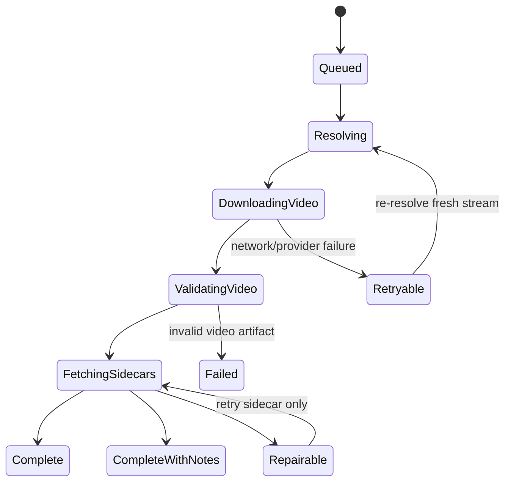

# Provider Usage Matrix

> Agent-facing (L3). Never linked from published docs. Users: see `docs/users/`.

This document normalizes and compares behavior across all Kunai provider engines to guide the Architecture V2 implementation.

## Elite Findings & Strategic Adjustments

- **Seek-bar Thumbnails:** Natively supported via `#EXT-X-IMAGE-STREAM-INF` (VidKing/Cineby), direct GQL `episodeInfos.thumbnails[]` (AllManga), and Pipe API VTT sprites (Miruro). These _must_ be mapped directly to MPV `--demuxer-mkv-subtitle-preroll` or handled via the TUI without extra network calls.
- **Release Schedule Reconciliation:** AllManga's `broadcastInterval` + `uploadDates` logic supersedes the need for AniList reconciliation for Anime.
- **ISO Language Normalization:** The shell strictly uses ISO 639-1 (e.g., `de`, `en`, `ja`). Engines are responsible for translating this into their specific backend quirks (Cineby's `killjoy`, AllManga's `translationType="sub"`, VidKing's `quality="Hindi"`).
- **State Handover:** When the user switches languages in the UI, if the provider treats Sub/Dub as separate episodes (e.g., AllManga), the Shell MUST restart the stream and pass `--start={currentTime}` to MPV to resume playback seamlessly.

## Live capability audit — 2026-11-27

Method: `apps/cli/test/live/provider-capability-audit.ts` ran the production
registry in an isolated profile across two movies, two series episodes, two
anime shows in sub and dub, and one YouTube fixture. "Resolved" means the
provider returned candidates; it is not playback. "Probe" is an independent
reachability probe of the selected candidate. "Decode" means mpv wrote a PNG
frame that was opened and confirmed to be real video. YouTube is the one
exception to ordinary URL probing: its watch-page locator is not a media URL,
so yt-dlp/mpv decode is the playback proof.

| Lane         | Provider                | Live state                                | Cases and proof                                                                                                          | Measured inventory                                                                                                   | Latency                      | Actual upstream dependency / independence                                                                                                                                                    |
| ------------ | ----------------------- | ----------------------------------------- | ------------------------------------------------------------------------------------------------------------------------ | -------------------------------------------------------------------------------------------------------------------- | ---------------------------- | -------------------------------------------------------------------------------------------------------------------------------------------------------------------------------------------- |
| movie/series | **VidLink**             | working                                   | 4/4 resolved, 4/4 probes reachable, Inception decoded at 1920x1080                                                       | 1080p DASH; `en/id/ms/tl` subtitles; audio and HDR not exposed                                                       | 1.57-1.87 s                  | `sacdn.hakunaymatata.com`; metadata path uses `vidlink.pro` + `enc-dec.app`; independent of the other measured CDNs                                                                          |
| movie/series | **Movy**                | working                                   | 4/4 resolved, 4/4 probes reachable, Inception decoded at 3840x2160                                                       | 15 lanes offered; selected rows 480p-2160p; English sidecars on 2/4 cases; audio/HDR not exposed                     | 2.87-5.27 s                  | `moon.goldenkite.top`; seed/metadata at `api.wecollege.net`; independent media CDN                                                                                                           |
| movie/series | **Rivestream**          | repaired; working                         | pre-fix 0/4; post-fix 4/4 resolved and probed, Fight Club decoded at 3840x2160                                           | first working backend `Riven`; movies 2160p, series 1080p; no usable ISO audio/subtitle metadata measured            | 2.09-4.56 s post-fix         | `scrapper.rivestream.app` API + `norway-canary.bigbang.cymru` media; aggregator backends can overlap VidRock CDNs such as `img1.hscow.com`, so independence is backend-specific              |
| movie/series | **VidRock**             | broken playback                           | 4/4 API resolves but 0/4 probes reachable; HTTP 502; no PNG                                                              | 4-7 servers; advertised `en/hi/ta`; no quality/subtitle inventory                                                    | 3.43-4.54 s to API inventory | `cdn.ngcloud.app`, `cdn2.ngcloud.app`, `img1.hscow.com`, `img1.fcxmb.com`; shares at least the `hscow` CDN family with some Rivestream backends                                              |
| movie/series | **Videasy**             | broken                                    | 0/4 resolved; every case timed out at 12 s                                                                               | none measured                                                                                                        | n/a                          | no media host reached; upstream shutdown evidence stands                                                                                                                                     |
| movie/series | **VidBolt**             | working, fragile tail fallback            | 3/4 resolved, 3/3 probes reachable; Fight Club decoded at 1920x1080; Inception timed out at 12 s                         | servers `orion/quantum/callisto/luna/vega`; 360p-1080p; audio `de/en/es/fr/hi/it/ja/pl/pt/tr`; 31 subtitle languages | 10.39-22.32 s                | `img/gzip.rousav.tech`, `proxy.vidbolt.xyz`, `stream.vidbolt.xyz`; Callisto uses shared `sbcdn7.hakunaymatata.com`; Orion/Rousav and VidBolt proxy lanes add materially independent capacity |
| anime        | **HiAnime**             | working sub+dub                           | 4/4 resolved and probed; One Piece E1 sub decoded at 1440x1080                                                           | 1080p HLS; `ja` sub / `en` dub; English subtitles; catalogs 1180 and 12 episodes                                     | 2.99-4.33 s                  | `hls.dramahot.top` via `ZokoAnime`                                                                                                                                                           |
| anime        | **KickAssAnime**        | mostly working                            | 3/4 resolved and probed; One Piece E1 sub decoded at 1920x1080; One Piece E1 dub had no playable server                  | 1080p HLS; `ja/en` audio; 4 subtitle languages on One Piece, 17 on Dandadan                                          | 4.83-7.24 s                  | `bl.krussdomi.com` and `hls.krussdomi.com` (`CatStream`/`VidStreaming`)                                                                                                                      |
| anime        | **AnimeGG**             | partial                                   | 1/4 resolved/probed/decoded: Dandadan E1 sub at 1920x1080; other cases timed out at 12 s                                 | 360p/480p/720p/1080p direct rows; Japanese audio; no separate subtitles measured                                     | 6.18 s for working case      | `vidcache.net:8161` media redirects from `www.animegg.org/play`; independent of the other measured anime CDNs                                                                                |
| anime        | **Miruro**              | broken from this network                  | numeric-ID smoke reached pipe, then connection reset; no stream/probe/decode                                             | none measured                                                                                                        | n/a                          | mirrors resolve and `.bz` root answers IPv4+IPv6, so not proven dead; pipe egress is blocked/reset                                                                                           |
| anime        | **AllManga / AllAnime** | catalog healthy; playback CAPTCHA-blocked | build-193 bootstrap 200/current; 0/4 stream resolves passed CAPTCHA; no probe/decode                                     | Dandadan catalog 12 episodes; no stream inventory measured                                                           | n/a                          | `api.mkissa.net` catalog/bootstrap; CAPTCHA wall before source CDNs                                                                                                                          |
| anime        | **AniLight**            | working sub+dub                           | 4/4 resolved and probed; One Piece E1 sub decoded at 1440x1080                                                           | `Sub/Dub kira` plus `misa backup`; 1080p MP4 and auto HLS; `ja/en`; 8 measured subtitle languages                    | 3.42-5.27 s                  | `api.anilight.live` + `media.satella.buzz`; edge hosts independent, ultimate proxied origin unproven                                                                                         |
| anime        | **Anidap**              | working sub+dub                           | 3/4 resolved and probed; One Piece E1 sub decoded at 1920x1080; One Piece E1 dub timed out, Dandadan dub resolved/probed | sub `nero/yuki/zuna/sora`, dub `nero/yuki/sora`; adaptive HLS; `ja/en`; 17 measured subtitle languages               | 5.81-9.65 s                  | adds independent `megavid.se`/`nexabloom.top` lanes, but `zuna` shares HiAnime's `dramahot` backend and `sora` shares KickAssAnime's `krussdomi` backend                                     |
| youtube      | **YouTube**             | working                                   | `Me at the zoo` resolved and decoded at 320x240                                                                          | 24 formats, 144p-240p (source-video limit); `de/en` subtitles                                                        | 2.02 s                       | YouTube watch metadata + Google media endpoints through yt-dlp; no relay                                                                                                                     |

Capacity reading: movie/series has four decode-proven providers (VidLink,
Movy, Rivestream, VidBolt), although VidBolt is slow and fragile enough that
it correctly remains the tail fallback. Anime has four broadly working
providers (HiAnime, KickAssAnime, AniLight, Anidap) plus one partial
independent fallback (AnimeGG). Anidap is dub-capable but its long-running
One Piece dub case timed out in the 2026-11-27 sweep; Dandadan dub resolved
and probed. YouTube works. VidRock, Videasy, Miruro, and
AllManga remain registered but must not count toward working-provider capacity
until a probed stream and decode frame exist. Anidap adds partially independent
capacity, not a clean fourth backend: some slots overlap HiAnime/KickAssAnime.

## Batch 2 verification — 2026-11-27

These are targeted runs, not a repeat of the full capability audit. The
[intake dossier](./2026-11-27-batch2-intake.md) records the raw frame hashes and
the candidates that did not qualify.

| Lane         | Provider          | Live proof                                                                                                                                                                | Measured inventory                                                                                                                                           | Media hosts                                                                                             |
| ------------ | ----------------- | ------------------------------------------------------------------------------------------------------------------------------------------------------------------------- | ------------------------------------------------------------------------------------------------------------------------------------------------------------ | ------------------------------------------------------------------------------------------------------- |
| movie/series | **FileSuN**       | Production CLI smoke: Fight Club selected stream reachable in a 4.10 s resolve. The movie and Game of Thrones S01E01 both decoded inspected 1280x720 frames.              | One server; 720p and 360p for Fight Club; one muxed audio stream, no alternate audio measured. No movie sidecars returned; Romanian VTT verified for S01E01. | `prx-1476-ant.vmpx.online`, `prx-1317-ant.vmpx.online`; Atlantic is lookup only.                        |
| anime        | **AnimeParadise** | Production CLI smoke: Frieren E01 selected stream reachable in a 10.51 s resolve. The exact positively gated adapter candidate also decoded an inspected 1920x1080 frame. | One HLS server and muxed original/sub audio; no dub observed. 1080p. Seven ASS/VTT tracks across `en`, `it`, `pt`, `es`.                                     | `stream.animeparadise.moe` for master, variants and segments; `api.animeparadise.moe` for ASS sidecars. |

With Batch 2 the measured roster is **five movie/series providers** and **five
working anime providers plus one partial** (AnimeGG), using the same counting
rules as the prior audit. Each new provider adds one distinct measured media
host family. AnimeParadise is sub-only, neither new backend showed 4K, and
Anidap's existing overlap still applies. Chillflix returned a decoded ad, not
title playback, so it adds no capacity and is not registered.

## Feature Matrix

| Provider       | Mode         | Search | Catalog | Sources     | Quality | Audio          | Soft Subs | Hardsub | Downloads                                                                                                                                                                                   | Notes                                                                                                                    |
| -------------- | ------------ | ------ | ------- | ----------- | ------- | -------------- | --------- | ------- | ------------------------------------------------------------------------------------------------------------------------------------------------------------------------------------------- | ------------------------------------------------------------------------------------------------------------------------ |
| **Videasy**    | series/movie | no     | no      | server-like | yes     | server-derived | yes       | maybe   | yes                                                                                                                                                                                         | Formerly VidKing; aliases include Cineplay/Cineby/HDToday/Bitcine. Language often hidden in `quality` string.            |
| **VidLink**    | series/movie | no     | no      | direct      | yes     | single         | yes       | maybe   | yes                                                                                                                                                                                         | TMDB id encrypted via enc-dec.app; `x-playback-environment` picks DASH+CDN-cookie lane over 429'd MP4 lane.              |
| **VidBolt**    | series/movie | no     | no      | server      | yes     | manifest       | yes       | maybe   | TMDB JSON API with `exclude` server iteration; signed `api_key` playlists require child-playlist credential propagation; Rousav obfuscated media paths need local `.ts` relay presentation. | TMDB JSON API with `exclude` server iteration; signed `api_key` playlists require child-playlist credential propagation. |
| **Cineby**     | series/movie | yes    | yes     | server      | yes     | server-derived | yes       | maybe   | yes                                                                                                                                                                                         | Valorant agent aliases (`killjoy`=de) dictate audio. Research only.                                                      |
| **AllManga**   | anime        | yes    | yes     | server      | yes     | sub/dub split  | yes       | yes     | yes                                                                                                                                                                                         | `translationType` is a first-class dimension. Native thumbnails.                                                         |
| **Miruro**     | anime        | no     | yes     | server      | yes     | sub/dub split  | yes       | yes     | yes                                                                                                                                                                                         | Identity by AniList id; no own search. `bee` (softsub) vs `kiwi` (hardsub). XOR pipe API.                                |
| **HiAnime**    | anime        | yes    | yes     | server      | yes     | sub/dub split  | yes       | yes     | yes                                                                                                                                                                                         | Retryable-failure allowlist; embed deobfuscation; hianime.at/zokoanime/aniwatchtv.                                       |
| **AniLight**   | anime        | yes    | yes     | server      | yes     | sub/dub split  | yes       | no      | yes                                                                                                                                                                                         | AniList bridge; opaque source URLs play through `media.satella.buzz`; missing dub fails closed.                          |
| **Anidap**     | anime        | yes    | yes     | server      | yes     | sub/dub split  | yes       | no      | yes                                                                                                                                                                                         | GraphQL catalog plus REST server slots; provider headers are part of playback; backend independence is slot-specific.    |
| **AniDB**      | anime        | yes    | yes     | sequential  | yes     | muxed          | maybe     | yes     | yes                                                                                                                                                                                         | Sequential resolver (no cycle); `catalog.missing` vs transient distinction drives re-search.                             |
| **Rivestream** | series/movie | no     | no      | server      | yes     | manifest       | yes       | maybe   | yes                                                                                                                                                                                         | Source/Quality merged in strings (`FlowCast (1080)`). All services behind one aggregator host.                           |
| **YouTube**    | video        | yt-dlp | n/a     | formats     | yes     | muxed          | yes       | no      | yes                                                                                                                                                                                         | yt-dlp spawn; `localOnly`, `relaySafe: false` by design; video mode, not movie/series.                                   |

---

## Normalized Source Inventory Recommendation

To ensure uniform cache identities and UI parity across all these disparate systems, the following TypeScript contract must be enforced for all `resolve()` returns.

```ts
type ProviderSourceInventory = {
  streams: Array<{
    id: string; // Hash of sourceId + quality + audioLanguage
    sourceId?: string; // The original provider server (e.g., "UNI", "FM-HLS")
    serverLabel?: string; // Cleaned UI label (e.g., "Filemoon")
    quality?: string; // Parsed out from merged strings, e.g., "1080p", "720p", "Auto"
    audioLanguage?: string; // STRICTLY ISO 639-1 code (e.g., "ja", "en", "de")
    subtitleMode?: "soft" | "hard" | "none" | "unknown";
    subtitleLanguage?: string; // Only applicable if hardsubbed, otherwise track via `subtitles`
    isEmbed?: boolean; // True if the stream is an iframe instead of an mp4/m3u8
    headers?: Record<string, string>; // Crucial for Origin/Referer bypasses
  }>;
  subtitles: Array<{
    id: string;
    language: string; // ISO 639-1
    format?: string; // "vtt", "ass", "srt"
    url?: string;
    embedded?: boolean; // True if multiplexed into the m3u8 stream
    forced?: boolean;
  }>;
  artwork?: {
    posterUrl?: string;
    thumbnailUrl?: string;
    backdropUrl?: string;
    seekBarVttUrl?: string; // Direct link to thumbnail sprite map
  };
};
```

---

## Download Recovery State Diagram

Downloads must use the exact same normalized `ProviderSourceInventory` as playback, preventing duplicated logic or misaligned cache keys.


