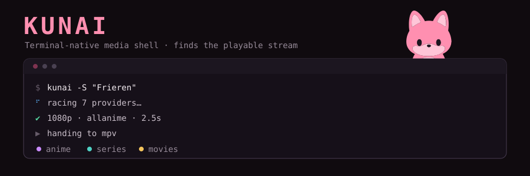
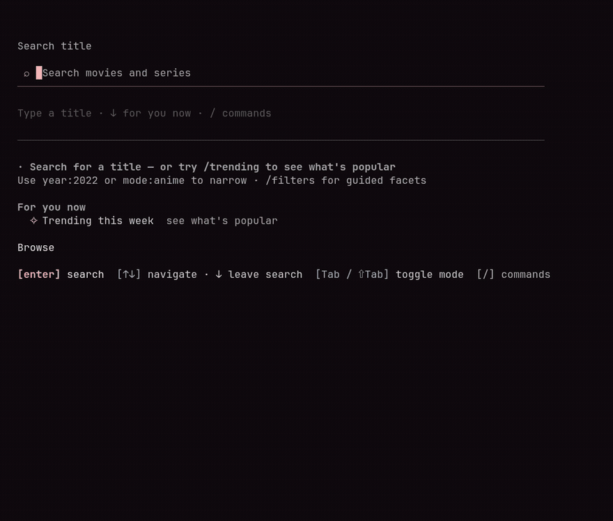

<div align="center">



**Watch anime, series and movies from your terminal in mpv.**
An ani-cli alternative with source failover, offline downloads and resume.

[](https://github.com/KitsuneKode/kunai/actions/workflows/ci.yml)
&nbsp;[](https://www.npmjs.com/package/@kitsunekode/kunai)
&nbsp;
&nbsp;
&nbsp;
&nbsp;[](LICENSE)



[Watch the sharper MP4](.reference/design/brand/demo-ui-walkthrough.mp4)

```bash
curl -fsSL https://kunai.kitsunekode.in/install.sh | bash
kunai --setup && kunai -S "Dune"
```

</div>

One fullscreen, keyboard-driven session: search a title, pick a third-party
source, and Kunai hands `mpv` a stream URL the provider already serves. No
browser, no tabs, no ads. History, queue, and downloads stay on your machine.

---

## Quick Start

### Install Kunai

```bash
curl -fsSL https://kunai.kitsunekode.in/install.sh | bash
```

```powershell
irm https://kunai.kitsunekode.in/install.ps1 | iex
```

```bash
npm install -g @kitsunekode/kunai
```

Then:

```bash
kunai                # interactive shell
kunai -S "Dune"      # straight into search
```

The binary embeds its runtime (no Bun or Node needed).

### Dependencies by platform

`mpv` is the only required dependency; `yt-dlp` (YouTube + downloads), `ffprobe`
(integrity checks), and curl (anime providers behind Cloudflare) are optional
and auto-detected.

```bash
sudo pacman -S mpv                         # Arch
sudo apt install mpv                       # Debian / Ubuntu
brew install mpv                           # macOS
winget install --id mpv-player.mpv-CI.MSVC -e   # Windows
```

Alpine, WSL, and optional-tool commands:
[Install and update](https://kunai.kitsunekode.in/docs/users/install-and-update) ·
[Platforms](https://kunai.kitsunekode.in/docs/users/platforms).

### Verify

```bash
kunai --version
mpv --version
kunai --setup
kunai -S "Dune"
```

## Kunai vs ani-cli

|                       | Kunai                                        | ani-cli                            |
| --------------------- | -------------------------------------------- | ---------------------------------- |
| Runtime and footprint | self-contained binary, Bun embedded (~88 MB) | small shell script, anywhere POSIX |
| Interface             | persistent fullscreen shell                  | one-shot prompts                   |
| Coverage              | anime, series, movies, YouTube               | anime                              |
| Streams               | probed before mpv sees them                  | as found                           |
| Between episodes      | Up Next, resume, continue watching           | relaunch                           |
| When a provider dies  | `⇧F` fallback without leaving playback       | pick another link                  |
| Offline               | download queue + local library               | `-d` download flag                 |
| List sync             | AniList and TMDB progress                    | AniList                            |
| Diagnostics           | `/diagnostics`, redacted export bundles      | player logs                        |
| Updates               | `kunai upgrade` in place                     | `ani-cli -U`                       |

ani-cli is excellent at its lane — small, POSIX-portable, scriptable anywhere —
and Kunai borrows from it openly; Kunai's pitch is the persistent shell and
everything past anime.

## Features

- **Type-ahead search** — your history and lists surface as you type, ghost completion included; `→` completes, `↓` jumps the band.
- **Verified streams** — candidates are probed before `mpv` sees them; a dead provider falls back to the next one with `⇧F`.
- **Provider switches** — turn any provider off in `/providers` or Settings; disabled providers stay out of resolve and fallback, including when every provider in a lane is disabled.
- **Live status board** — a daily sweep publishes per-provider health; the shell already routes around failures on its own.
- **Up Next and queue** — build tonight's run order in-shell and undo slips with `z`.
- **Offline downloads** — a persisted queue, speed and ETA rows, automatic resume after a restart, and a local library.
- **Release calendar** — one window across anime, series, and movies, filtered by type or day.
- **Command palette** — `/` reaches every surface, including JUMP TO title rows.
- **Themes** — eight palettes via `/theme` or Settings, repainted instantly.
- **Discord Rich Presence** — opt-in, over local IPC, no extra service.
- **Autoskip** — intros, recaps, and credits skipped when IntroDB/AniSkip data exists.
- **Local-first** — analytics is off by default; nothing is sent unless you turn it on.

### Inside the shell

Every screen shows its own keys in the footer. The few you will reach for:

```text
/    command palette      ⇧F   provider fallback during playback
?    help overlay         r    recover a stalled stream
Tab  switch lane (series / anime / YouTube) · Ctrl+C  quit
```

Full registry: [commands and shortcuts](https://kunai.kitsunekode.in/docs/users/commands-and-shortcuts).

## Docs

- [Install and update](https://kunai.kitsunekode.in/docs/users/install-and-update) · [Platforms](https://kunai.kitsunekode.in/docs/users/platforms)
- [Commands and shortcuts](https://kunai.kitsunekode.in/docs/users/commands-and-shortcuts) · [Configuration](https://kunai.kitsunekode.in/docs/users/customization)
- [Providers](https://kunai.kitsunekode.in/docs/users/providers) · [Troubleshooting](https://kunai.kitsunekode.in/docs/users/troubleshooting)
- [Provider status](https://kunai.kitsunekode.in/docs/users/provider-status) · [Community](https://kunai.kitsunekode.in/docs/users/community)
- [Downloads and offline](https://kunai.kitsunekode.in/docs/users/downloads-and-offline) · [Diagnostics](https://kunai.kitsunekode.in/docs/users/diagnostics-and-reporting)
- [Uninstall](https://kunai.kitsunekode.in/docs/users/install-and-update#uninstall) · [FAQ / troubleshooting](https://kunai.kitsunekode.in/docs/users/troubleshooting)

Keep it current with `kunai upgrade`; `kunai uninstall` removes it and keeps
your data unless you pass `--purge`.

Kanna, the fox you see on setup and empty shelves, lives at
[kunai.kitsunekode.in/docs/users/kanna](https://kunai.kitsunekode.in/docs/users/kanna).
`KUNAI_PET=off` retires her.

Contributions are welcome: bug fixes, provider parity, platform testing. See
[CONTRIBUTING.md](CONTRIBUTING.md). Built on the shoulders of ani-cli, mpv,
yt-dlp, AniSkip, and VLC.

---

## Disclaimer

Kunai is a client-side playback tool. It does not host, upload, mirror, seed, or
distribute video content. Streams and related assets are served by non-affiliated
third-party providers. Use responsibly and in accordance with applicable laws and
service terms.

## License

Kunai is licensed under **MIT OR Apache-2.0**, at your option. See [LICENSE](LICENSE)
for both complete texts. Separately identified third-party components retain their
own license terms and notices. Published releases keep their original licensing.
